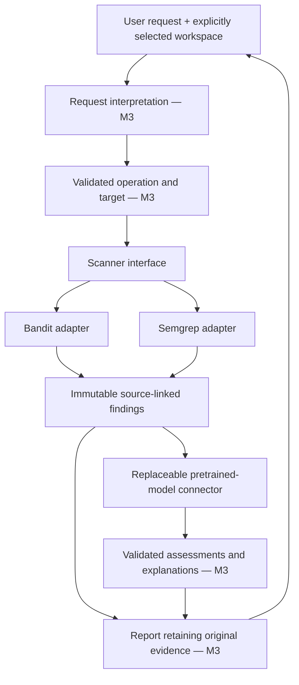

# Milestone 2 — system design, component connections and development material

Date: 2026-09-19. Status: **completed within the provisional scope**. This is an engineering record, not thesis prose. Supervisor confirmation is pending.

## Decisions and scope

The user selected source-code analysis and requested that we use a pretrained model rather than train a new one. The working target language is Python; this narrower choice was made by the assistant and can be revised. The current scope is a local, single-user assistant that supports static analysis and interpretation of findings. It does not claim autonomous discovery of all vulnerabilities.

The planned contribution is the integration and evaluation of a pretrained model with deterministic analysis, including natural-language interaction and evidence-based explanation. Training, fine-tuning and inventing a new detection algorithm are outside the current plan. This interpretation should be confirmed with the supervisor before milestone 3.

Milestone 2 includes connector scaffolding and integration diagnostics because the work plan requires establishing the relationship between model and tools. It does not implement the complete natural-language workflow scheduled for milestone 3.

## Proposed architecture

| Component | Responsibility | M2 state |
| --- | --- | --- |
| Source workspace | Resolve a relative Python file inside an explicitly selected root; enforce file type and size | Implemented for individual files, 256 KiB limit |
| Scanner protocol | Tool-neutral `scan(relative_path)` operation | Implemented |
| Local adapters | Invoke fixed scanner commands without a shell, parse output and retain raw evidence | Bandit and Semgrep implemented |
| Finding/report contracts | Preserve tool, rule, relative location, source hash, original severity/confidence and errors | Implemented using strict Pydantic records |
| Model connector | Local non-streaming Ollama API call with a response schema, timeout and explicit error handling | Implemented |
| Connection diagnostic | Send real scanner finding metadata to the real model and validate the acknowledgement | Implemented and exercised |
| Natural-language interpreter | Convert a user request to a restricted operation, not an arbitrary shell command | Specified, not implemented |
| Assessment/explanation layer | Reference supplied finding IDs, flag uncertainty and preserve original evidence | Specified, not implemented |
| Final report and user interface | Present findings, limitations and failures | Milestone 3 |

Code: `src/vuln_assistant/`. Local rules: `rules/m2_python.yml`. Diagnostic prompt: `prompts/connection_ack.txt`. Repeatable integration run: `scripts/m2_diagnostic.py`.

### Contracts and trust boundaries

- A `ScanReport` explicitly distinguishes `completed` from `failed`; zero findings alone does not mean that analysis succeeded or that the file is secure.
- Finding identities include the source hash, tool, rule, relative filename and line. A finding from a changed source must not silently be treated as the same evidence.
- Source bytes are parsed as Python 3.11 syntax before the external scan. Unsupported or invalid syntax fails explicitly. Files are inspected, never imported or executed by the diagnostic.
- Scanner error arrays, unexpected exits, missing scanned targets, foreign result paths, malformed JSON and source changes during a run are rejected. Raw stdout/stderr and the fixed command are retained.
- Bandit severity, confidence and CWE are preserved as reported. They are not rewritten to match our corpus annotations. Tool confidence is not a calibrated probability of exploitability.
- The model endpoint is explicitly loopback-only, does not use environment proxies or follow redirects, and receives no executable tool definitions. The server is launched with cloud features disabled.
- The connection acknowledgement must contain exactly the supplied finding IDs and source tool. A schema-valid but invented ID fails validation.
- Later natural-language operations should be limited to analysis, clarification and explanation. Inspected code, comments and scanner messages remain data rather than instructions. Schema validation is not a complete prompt-injection defence.

The current adapters are **not an OS sandbox**, a hostile-repository service, or a multi-user application. Root/path checks and before/after source hashes do not eliminate adversarial filesystem races. M3 must define snapshotting, directory collection, resource limits and presentation behaviour before supporting arbitrary projects.

## Selected local model and replaceability

- Runtime: portable **Ollama 0.34.2**, official Windows release. Archive SHA-256 checked against GitHub release metadata before execution.
- Model: **qwen2.5-coder:7b**, GGUF, 7.6B parameters, Q4_K_M, 4,683,087,561 bytes as reported by the local API.
- Exact model manifest digest: `dae161e27b0e90dd1856c8bb3209201fd6736d8eb66298e75ed87571486f4364`.
- Diagnostic settings: context 4096, temperature 0, seed 0, output limit 256 tokens; unload after the call. Fixed settings aid comparison but do not guarantee bit-identical results across hardware/runtime versions.
- Selection reason: an available code-oriented instruction model suitable for a local integration trial on the measured machine, without paid inference or training. This is not a model-quality ranking.
- The actual runtime/model metadata and licence text are preserved in `artifacts/m2/model-install.json`; archive provenance is in `artifacts/m2/runtime-install.json`.

Model identity is a connector parameter and is recorded at run time. A different model using the same API need not change scanners or corpus. A different provider needs a connector with the same validated data boundary. Tags may change upstream: compare the actual digest before interpreting a reproduction as the same model.

## Development data and workflow cases

`data/m2/manifest.json` describes 18 original synthetic snippets across three scoped weaknesses:

| Category | Proposed vulnerable | Paired fixes | Contextual controls |
| --- | ---: | ---: | ---: |
| Eval injection, CWE-95 | 2 | 2 | 2 |
| OS command injection, CWE-78 | 2 | 2 | 2 |
| SQL injection, CWE-89 | 2 | 2 | 2 |

Each record has an ID, group, source path, SHA-256, rationale and provisional label. The labels were created through assistant source inspection; independent human review remains necessary. The controls intentionally include constant expressions, local name shadowing, nonexecuted query text and integer-constrained interpolation.

All 18 cases are development data. They must not be promoted to an unseen final test set. Paired revisions and related variants must remain grouped. Future model evaluation should use neutral filenames and remove label-bearing metadata from prompts; the current descriptive filenames are convenient for development but would leak labels in a detection benchmark.

`data/m2/requests.json` adds 12 Hungarian/English acceptance scenarios covering normal analysis, explanation, ambiguous requests, missing targets, workspace escapes, requests for network scans, destructive actions and attempts to fabricate results. These are **prepared scenarios**, not a tested natural-language feature.

No third-party vulnerable projects or public systems were scanned. For M4, prepare a separately reviewed dataset containing realistic vulnerable/fixed code with documented provenance and applicable terms, after the supervisor confirms scope.

## Verification and observed results

Final connector diagnostics: `artifacts/m2/20260919T111932119119Z/`.

- **40 automated tests passed**, including the six retained M1 checks. Tests exercise real scanners, invalid syntax, workspace restrictions, missing/scanned targets, source changes, timeouts, malformed responses, redirects, schema failures and invented evidence IDs.
- **36 development-corpus scans completed:** two adapters × 18 snippets. All report successful processing, not universal vulnerability detection.
- Bandit produced findings on 10 of the 18 snippets; the three local Semgrep rules produced findings on 8. These are raw development observations, not benchmark accuracy scores or a fair full-tool comparison.
- Both configurations missed the indirect eval-alias example. Both warned on some contextual controls. Bandit found the concatenated SQL example that the narrow Semgrep SQL rule did not cover. Preserve these differences for later analysis instead of tuning them away for a perfect demo.
- The real local model received metadata for one Bandit finding and returned the correct tool and exact finding ID in the required schema. This proves the scanner-to-model connection, **not vulnerability reasoning, explanation quality or natural-language control**.
- The runtime reported approximately 33.17 seconds total for this cold diagnostic call, including approximately 18.17 seconds loading. This single short call is not a representative performance benchmark.
- Ruff checks passed. Exact source/configuration hashes, package versions, commands, raw scan outputs, model request/response and model identity were saved with the run.

### Failure found and fixed during M2

The first test run had 39 passing checks and one failure: Semgrep returned a successful empty result for the malformed source `def broken(:`. The raw pre-fix observation and initial failing test report are preserved in `artifacts/m2/investigations/`.

The adapter now performs a separate Python syntax check before interpreting scanner output. Both adapters report this input as failed, and the subsequent test run passed all 40 checks. This is a local observation about the tested version/input, not a blanket statement about all Semgrep parsing behaviour.

The server-stop helper initially refused to stop its own process because this PowerShell version converts JSON timestamps into date objects. String comparison was replaced with UTC tick comparison while retaining the executable/PID identity check. A subsequent stop/start/stop cycle succeeded. The pre-fix helper is preserved under `artifacts/m2/investigations/`; this helper change followed the integration run and does not alter its scanner/model results. The project model server is stopped at handoff.

## Provisional evaluation plan for M3–M4

Research questions to confirm with the supervisor:

1. Can the assistant correctly translate bounded Hungarian/English requests into supported analysis operations?
2. Does the model improve the usefulness or assessment of scanner findings without introducing unsupported claims or hiding real findings?
3. What are the latency, repeatability and failure-handling costs of adding the model?

The minimum comparison is **the same scanner configuration alone versus the same configuration with model assistance**, on the same held-out cases. Keep original findings visible. A third model-only condition is optional if it answers a separate question and resources permit.

Define matching at case/weakness level before evaluation. Keep false positives, false negatives, tool failures and model abstentions separate; report counts and denominators beside precision, recall, F1 and false-positive rate. Evaluate explanation support and request understanding separately from detection. Repeat model runs and record versions/settings. Do not use the model's own opinions as the ground truth for its evaluation.

No improvement claim is justified by M2. If M4 finds no detection benefit, reliable orchestration, clearer explanations and measured limitations may still be valid engineering results, subject to the supervisor's expectations.

## Handling changes after the supervisor meeting

| Change | Reusable parts | Work to revise |
| --- | --- | --- |
| Different local model | Scanner adapters, findings, source controls, development checks | Model choice/settings, compatibility check, repeat AI evaluations |
| Different source language | Connector contracts, logging, model interface, workflow concept | Parser, scanner rules/adapters, corpus and related language-specific tests |
| Additional weakness types | Existing integration and records | Rules, examples, scope and evaluation coverage |
| Require model training | Source evidence, baseline analyzers, much evaluation infrastructure | Dataset strategy, training pipeline, resources and schedule; substantial new work |
| Switch to running web applications | Model interface, logging and parts of reporting | Dynamic-analysis adapter, local target environment and different evaluation protocol; substantial scope change |

The design reduces rework; it does not make every scope change free. Confirm the research contribution and target language before investing in the full M3 workflow.

## M2 completion checklist

- [x] Provisional scope, component responsibilities and boundaries recorded.
- [x] Replaceable scanner interface and validated finding/report contracts created.
- [x] Two local analyzer connectors established and tested.
- [x] Real pretrained local model installed with provenance and exercised through its connector.
- [x] Development corpus, paired cases, metadata and workflow scenarios organised.
- [x] Evidence, failure investigation and reproduction instructions preserved.
- [x] Supervisor discussion brief prepared separately.
- [ ] Supervisor confirmation — pending the user's meeting, not represented as already obtained.

Next: milestone 3 implementation after scope confirmation or further user instruction. The thesis manuscript remains deferred until after all four milestones.
