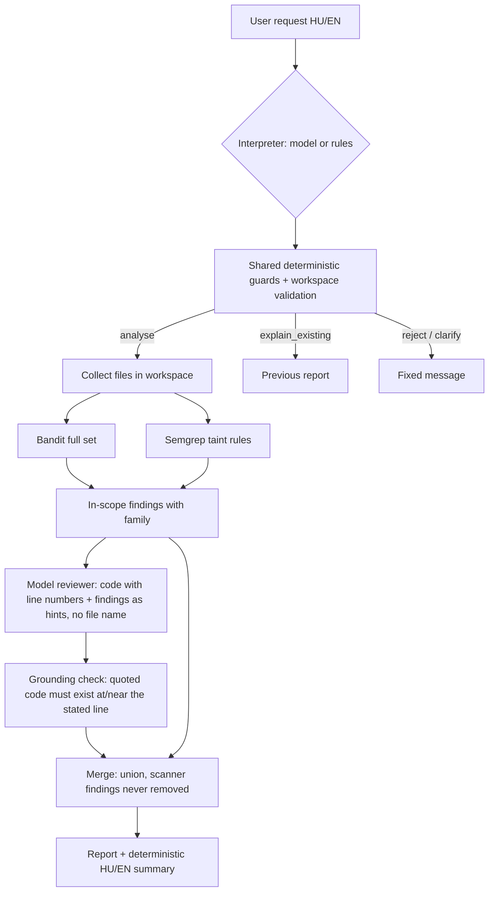

# Milestone 3 — detection, explanation and natural-language control

Started: 2026-10-17 (authorised by the user after the supervisor feedback). This is an engineering record, not thesis prose. Status lines distinguish **implemented**, **verified on the target machine** and **measured**.

## Inputs to this milestone

- Supervisor feedback (reported by the user, 2026-10-17; verbatim in `RESEARCH_LOG.md`): pretrained model, no training; no new detection method required; Python with CWE-95/78/89; AI priority **detection > explanation > natural-language control > false-positive recognition**; scanner vs. same scanner + AI comparison with accuracy, precision and recall; small own code units suffice.
- Code review of the M2 implementation (2026-10-17). Findings and resolutions are listed below.

## Code review of M2 and resolutions

| # | Finding (evidence) | Resolution |
| --- | --- | --- |
| 1 | Bandit reports **CWE-78 for eval (B307)** (`artifacts/m2/20260919T111932119119Z/bandit-eval_direct_bad.json`). Per-family scoring on the tool CWE would be wrong. | `Finding.cwe` keeps the tool value; new `Finding.family` comes from a project map by rule ID (`scanners.BANDIT_FAMILY`) or from our Semgrep rule metadata. |
| 2 | Semgrep rule IDs embed the absolute config path including the Windows user name (`C.Users.istu2.Documents.Szakdoga.rules.m2-python-eval`), making finding IDs machine-dependent. | `normalise_semgrep_rule` keeps the last segment. **Consequence:** Semgrep finding IDs differ from the IDs stored in the M2 artifacts; counts and rules are unchanged. |
| 3 | Bandit limited to B307/B602/B608; `exec`, `os.system`, `os.popen`, paramiko, Django raw SQL are missed. | M3 profile runs the full Bandit test set; out-of-scope findings are kept with `family = None` and not scored. Informational checks (B404, B603, B606, B607) are deliberately not mapped. |
| 4 | Semgrep rules were syntactic patterns, so they fire on constants and miss data flow. | New `rules/m3_python_taint.yml`: taint mode, sources = function parameters / `input()` / `sys.argv` / environment; sanitizers = `int`, `float`, `shlex.quote` (shell), `ast.literal_eval` (eval); sinks = eval/exec, shell commands, `execute`. Written from CWE semantics, not tuned per case. CE taint is intra-procedural. |
| 5 | Model settings hard-coded (ctx 4096, 256 tokens, unload after every call): each call was cold (M2: 33.17 s total, 18.17 s load). Model digest not checked at run time. | `ModelSettings` per call type, recorded with every outcome; batch runs keep the model loaded (`keep_alive` 10 min) and unload at the end; `metadata(expected_digest)` fails if the tag moved. |
| 6 | Only single files could be analysed. | `SourceWorkspace.collect` accepts a file or directory (hidden/environment folders skipped, links leaving the root refused, file-count limit). |
| 7 | Both scanners lived in one branching function; no place for a third detector. | `SubprocessScanner` base class with `BanditScanner` / `SemgrepScanner`; versioned profiles `m2` (reproduces M2) and `m3`. `LocalScanner` kept as the M2 entry point. |
| 8 | No version control. | Git history reconstructed: M1–M2 baseline snapshot → supervisor-feedback documents → M3. `scripts/init_git.ps1` creates the repository from `scripts/git/history.bundle` and commits existing evidence on top. |

Kept unchanged because they were sound: explicit `failed` status instead of empty results, syntax pre-check, raw-evidence retention, loopback-only schema-validated model access.

## Architecture (implemented)

| Module | Responsibility |
| --- | --- |
| `scanners.py` | Adapters, family map, profiles |
| `review.py` | Model detection + explanation in one structured call |
| `analysis.py` | Records, grounding, merge (pure logic) |
| `pipeline.py` | Orchestration, completeness tracking |
| `report.py` | Fixed-wording HU/EN rendering; model text is labelled as model output |
| `intent.py` | Rule and model interpreters, guards, target validation |
| `cli.py` | `analyse` and `ask` commands, previous-report state |
| `metrics.py` | Case-level accuracy, precision, recall with counts |

### Design decisions and alternatives considered

- **Model role = detector + explainer** (supervisor priority). The model sees the numbered source and in-scope scanner findings as hints, and returns issues (reasoning first, then family, line, exact code quote, input source, explanation, fix) plus optional dismissals. *Alternative considered:* model only re-ranks scanner findings (false-positive triage) — rejected because the supervisor ranked it last. *Alternative:* separate explanation call per finding — rejected for latency; one call per file.
- **Union merge.** Scanner findings are never removed; model dismissals are recorded only. Consequence: AI can raise recall but cannot raise precision in the current policy. A precision-oriented policy (e.g. drop a finding when the model dismisses it) is a possible M4 ablation, not the default, because false-positive recognition was ranked last and silent removal is a safety risk.
- **Grounding check.** A model issue becomes a detection only if its quoted code is found on the stated line (±2 lines, with correction recorded). Ungrounded claims are kept as evidence and counted. This limits hallucinated line numbers; it does not verify that the claimed family is correct.
- **No file name to the model.** Development file names contain labels (`*_bad.py`); the reviewer prompt omits the path entirely.
- **Inspected content is data.** Source and scanner messages are delimited in the user message; the system prompt forbids following embedded instructions. Schema validation, grounding and the union policy bound the damage of a successful injection, but are not a complete defence.
- **Natural-language control:** the model proposes an `Intent`; deterministic guards (network targets, destructive actions, instruction override, result fabrication, absolute/parent paths) override it, a target must literally appear in the request, and it must resolve inside the workspace. If the model fails, the rule interpreter is used and this is reported.
- **Rule interpreter** exists as a baseline and fallback. It was written with the 12 development scenarios in view.
- Package version stays 0.0.2 so `uv.lock` remains valid without network access.

## Development material

- 18-case development corpus (`data/m2`), unchanged. Development data only.
- 12 request scenarios (`data/m2/requests.json`), unchanged. Development data only.
- New unit snippets inside `tests/test_m3_scanners.py` check rule semantics; they are not evaluation data.

## Verification status

- Implemented in the assistant's workspace. Lint passed (Ruff 0.16.8). Pure-logic parts (grounding, merge, rendering, metrics, rule interpreter on the 12 scenarios, pipeline with a simulated model) were exercised with Python 3.13 + Pydantic 2.13.5 in the assistant's cloud workspace.
- **Not yet run on the target machine** (Windows, Python 3.11.13, real Bandit/Semgrep/Ollama): the cloud workspace could not install Bandit/Semgrep (package index blocked), and the assistant cannot type into a terminal on the user's computer. The one-command check `scripts/m3_check.ps1` produces all evidence under `artifacts/m3/check-<UTC>/`.

## Evaluation plan carried to M4 (proposal)

- Held-out test set: new cases written and labelled before running the system, neutral file names, labels stored separately; ideally the supervisor's offered examples.
- Conditions: scanners (`m3:scanners`) vs. scanners + model, same cases; Bandit and Semgrep alone as references.
- Metrics: accuracy, precision, recall with TP/FP/TN/FN; repeated model runs (stability); latency as auxiliary data.
- Explanation quality: manual rubric (`explanations.md` sheet), scored by the user, not by the model.
- Request understanding: new paraphrased requests written independently of the rules.
