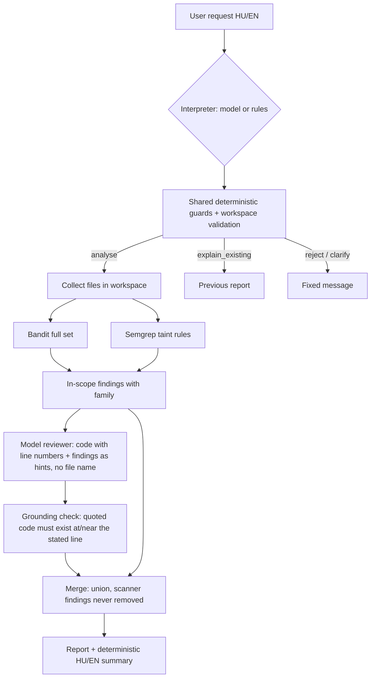

# Milestone 3 — detection, explanation and natural-language control

Started and closed: 2026-10-17 (authorised by the user after the supervisor feedback). This is an engineering record, not thesis prose. Status lines distinguish **implemented**, **verified on the target machine** and **measured**.

## Inputs to this milestone

- Supervisor feedback (reported by the user, 2026-10-17; verbatim in `RESEARCH_LOG.md`): pretrained model, no training; no new detection method required; Python with CWE-95/78/89; AI priority **detection > explanation > natural-language control > false-positive recognition**; scanner vs. same scanner + AI comparison with accuracy, precision and recall; small own code units suffice.
- Code review of the M2 implementation (2026-10-17). Findings and resolutions are listed below.

## Code review of M2 and resolutions

| # | Finding (evidence) | Resolution |
| --- | --- | --- |
| 1 | Bandit reports **CWE-78 for eval (B307)** (`artifacts/m2/20260919T111932119119Z/bandit-eval_direct_bad.json`). Per-family scoring on the tool CWE would be wrong. | `Finding.cwe` keeps the tool value; new `Finding.family` comes from a project map by rule ID (`scanners.BANDIT_FAMILY`) or from our Semgrep rule metadata. |
| 2 | Semgrep rule IDs embed the absolute config path including the Windows user name (`C.Users.istu2.Documents.Szakdoga.rules.m2-python-eval`), making finding IDs machine-dependent. | `normalise_semgrep_rule` keeps the last segment. **Consequence:** Semgrep finding IDs differ from the IDs stored in the M2 artifacts; counts and rules are unchanged. |
| 3 | Bandit limited to B307/B602/B608; `exec`, `os.system`, `os.popen`, paramiko, Django raw SQL are missed. | M3 profile runs the full Bandit test set; out-of-scope findings are kept with `family = None` and not scored. Informational checks (B404, B603, B606, B607) are deliberately not mapped. |
| 4 | Semgrep rules were syntactic patterns, so they fire on constants and miss data flow. | New `rules/m3_python_taint.yml`: taint mode, sources = function parameters / `input()` / `sys.argv` / environment; sanitizers = `int`, `float`, `shlex.quote` (shell), `ast.literal_eval` (eval); sinks = eval/exec, shell commands, `execute`. Written from CWE semantics, not tuned per case. CE taint is intra-procedural. |
| 5 | Model settings hard-coded (ctx 4096, 256 tokens, unload after every call): each call was cold (M2: 33.17 s total, 18.17 s load). Model digest not checked at run time. | `ModelSettings` per call type, recorded with every outcome; batch runs keep the model loaded (`keep_alive` 10 min) and unload at the end; `metadata(expected_digest)` fails if the tag moved. |
| 6 | Only single files could be analysed. | `SourceWorkspace.collect` accepts a file or directory (hidden/environment folders skipped, links leaving the root refused, file-count limit). |
| 7 | Both scanners lived in one branching function; no place for a third detector. | `SubprocessScanner` base class with `BanditScanner` / `SemgrepScanner`; versioned profiles `m2` (reproduces M2) and `m3`. `LocalScanner` kept as the M2 entry point. |
| 8 | No version control. | Git history reconstructed: M1–M2 baseline snapshot → supervisor-feedback documents → M3. `scripts/init_git.ps1` creates the repository from `scripts/git/history.bundle` and commits existing evidence on top. |

Kept unchanged because they were sound: explicit `failed` status instead of empty results, syntax pre-check, raw-evidence retention, loopback-only schema-validated model access.

## Architecture (implemented)

| Module | Responsibility |
| --- | --- |
| `scanners.py` | Adapters, family map, profiles |
| `review.py` | Model detection + explanation in one structured call |
| `analysis.py` | Records, grounding, merge (pure logic) |
| `pipeline.py` | Orchestration, completeness tracking |
| `report.py` | Fixed-wording HU/EN rendering; model text is labelled as model output |
| `intent.py` | Rule and model interpreters, guards, target validation |
| `cli.py` | `analyse` and `ask` commands, previous-report state |
| `metrics.py` | Case-level accuracy, precision, recall with counts |

### Design decisions and alternatives considered

- **Model role = detector + explainer** (supervisor priority). The model sees the numbered source and in-scope scanner findings as hints, and returns issues (reasoning first, then family, line, exact code quote, input source, explanation, fix) plus optional dismissals. *Alternative considered:* model only re-ranks scanner findings (false-positive triage) — rejected because the supervisor ranked it last. *Alternative:* separate explanation call per finding — rejected for latency; one call per file.
- **Union merge.** Scanner findings are never removed; model dismissals are recorded only. Consequence: AI can raise recall but cannot raise precision in the current policy. A precision-oriented policy (e.g. drop a finding when the model dismisses it) is a possible M4 ablation, not the default, because false-positive recognition was ranked last and silent removal is a safety risk.
- **Grounding check.** A model issue becomes a detection only if its quoted code is found on the stated line (±2 lines, with correction recorded). Ungrounded claims are kept as evidence and counted. This limits hallucinated line numbers; it does not verify that the claimed family is correct.
- **No file name to the model.** Development file names contain labels (`*_bad.py`); the reviewer prompt omits the path entirely.
- **Inspected content is data.** Source and scanner messages are delimited in the user message; the system prompt forbids following embedded instructions. Schema validation, grounding and the union policy bound the damage of a successful injection, but are not a complete defence.
- **Natural-language control:** the model proposes an `Intent`; deterministic guards (network targets, destructive actions, instruction override, result fabrication, absolute/parent paths) override it, a target must literally appear in the request, and it must resolve inside the workspace. If the model fails, the rule interpreter is used and this is reported.
- **Rule interpreter** exists as a baseline and fallback. It was written with the 12 development scenarios in view.
- Package version stays 0.0.2 so `uv.lock` remains valid without network access.

## Development material

- 18-case development corpus (`data/m2`), unchanged. Development data only.
- 12 request scenarios (`data/m2/requests.json`), unchanged. Development data only.
- New unit snippets inside `tests/test_m3_scanners.py` check rule semantics; they are not evaluation data.

## Verification status

- Implemented and lint-checked in the assistant's workspace on 2026-10-17; pure logic exercised with a simulated model.
- **Verified on the target machine** on 2026-10-17 (`artifacts/m3/check-20261017T104137Z/`, all steps exit code 0): Ruff passed; pytest 88/88; the M2 diagnostic reproduced all 36 statuses and finding counts of 2026-09-19 exactly; model digest checked at run time.
- First attempt (`check-20261017T102331Z`) hung: the model-server step captured output through a pipe that the background `ollama.exe` inherited. Fixed by starting/stopping the server outside the pipe.

## Development results (development corpus — not a final evaluation)

Unit: file with respect to its labelled family; 6 vulnerable, 12 non-vulnerable cases. Model: qwen2.5-coder:7b Q4_K_M, temperature 0, seed 0, num_ctx 8192; Hungarian explanation language; 3 repeats.

| Condition | TP | FP | TN | FN | Accuracy | Precision | Recall |
|---|---|---|---|---|---|---|---|
| Bandit, full set | 5 | 5 | 7 | 1 | 0.667 | 0.500 | 0.833 |
| Semgrep taint rules | 5 | 1 | 11 | 1 | 0.889 | 0.833 | 0.833 |
| Bandit ∪ Semgrep (system without AI) | 5 | 5 | 7 | 1 | 0.667 | 0.500 | 0.833 |
| Bandit ∪ Semgrep + model (3 identical repeats) | 6 | 9 | 3 | 0 | 0.500 | 0.400 | 1.000 |

- The model added one true detection (aliased eval, missed by both scanners) and four false positives the scanners did not raise: `ast.literal_eval`, a command that only appears in a string, and two bound-parameter SQL queries. Its reasoning in those cases is factually wrong (it describes bound parameters as concatenation).
- Repeats were identical; no model failures; no ungrounded claims (the grounding check never fired); no dismissals. Median 3.85 s per file warm, 41.2 s for the cold first call.
- Request interpretation on the 12 development scenarios: rules 12/12; model 12/12 actions, 9/12 all fields (language wrong twice, family filter taken from a file name once).
- End-to-end demo (`demo/transcript.txt`) works. Hungarian explanations are understandable but uneven (untranslated "untrusted data", `%s` placeholder suggested for sqlite).

Interpretation: with the current small model and union policy, the AI raises recall but lowers precision and accuracy on development data. Taint-mode Semgrep is the strongest single component here, but its rules were written with knowledge of this corpus, so M4 must confirm this on held-out data.

## Second development iteration (implemented 2026-10-17, target run pending)

The five proposals below were approved by the user, including the download of a larger local model.

- Request interpretation: language always detected deterministically; a proposed family filter is kept only if the request words (excluding paths) support it.
- Review call: analysis and reasoning in English; input source, explanation and fix in the user's language; fixes must keep the code's library/API conventions.
- Verification: each model-only claim (not attached to a scanner finding) gets a second, focused call (trace → attacker_controlled → reaches_dangerous_operation → neutralised → verdict). It becomes a detection only when every answer is consistent with "vulnerable". The original reasoning is withheld from the verifier. Verification failures make the report incomplete.
- Models: qwen2.5-coder:7b and qwen2.5-coder:14b under identical settings; context size fitted per call (4096/8192/16384) so the 14B model fits in 12 GB VRAM.
- Conditions: scanner layer "union" (Bandit ∪ Semgrep) and "semgrep" (Semgrep taint only), each with the model receiving only that layer's findings as hints; ablation without verification; 2 repeats.

Caveat: the verification and review prompt wording encodes CWE-definition knowledge that was added after observing the first run's development false positives. Development results of this iteration are therefore optimistic; only held-out data (M4) can confirm an improvement.

### Second iteration results (target machine, `artifacts/m3/check-20261017T110519Z/`)

| Condition | TP | FP | TN | FN | Accuracy | Precision | Recall |
|---|---|---|---|---|---|---|---|
| Semgrep taint (no AI) | 5 | 1 | 11 | 1 | 0.889 | 0.833 | 0.833 |
| Bandit ∪ Semgrep (no AI) | 5 | 5 | 7 | 1 | 0.667 | 0.500 | 0.833 |
| Bandit ∪ Semgrep + 7B | 6 | 10 | 2 | 0 | 0.444 | 0.375 | 1.000 |
| Semgrep + 7B | 6 | 8 | 4 | 0 | 0.556 | 0.429 | 1.000 |
| Bandit ∪ Semgrep + 14B | 6 | 7 | 5 | 0 | 0.611 | 0.462 | 1.000 |
| Semgrep + 14B | 6 | 4 | 8 | 0 | 0.778 | 0.600 | 1.000 |

- All repeats identical. The only new true positive is the aliased eval in every model condition.
- 14B beats 7B in every condition, follows the English-reasoning instruction (7B does not) and writes better Hungarian.
- Self-verification by the same model barely filters: the no-verify ablation equals the verified union results for both models; it rejected 2 claims per model only in the Semgrep layer (14B correctly rejected the `int()`-constrained SQL). Confirmation bias is the likely cause; report as a negative result.
- Remaining 14B false positives: list-argument subprocess without a shell, and dangerous-looking text that is only a string literal.
- Request scenarios: rules, 7B and 14B all 12/12 on every field. Median latency per file: 7B ≈ 4.7 s, 14B ≈ 7.1 s.
- Correction: the corpus code does not reveal the database driver, so `%s` versus `?` placeholders cannot be judged from the code.

Recommendation (awaiting decision): 14B as default model; Semgrep taint as the "without AI" baseline with Bandit as a reference; keep verification but do not claim it improves precision; one last deterministic structural check (a model-only claim must point at a real call on that line, not at text inside a string literal); then freeze the configuration and evaluate on held-out data (M4).

## Milestone 3 closure (2026-10-17)

Closing run: `artifacts/m3/check-20261017T113935Z/` (snapshot `a40b1d4`), all steps exit code 0, pytest 94/94.

| Condition | TP | FP | TN | FN | Accuracy | Precision | Recall |
|---|---|---|---|---|---|---|---|
| Semgrep taint (no AI, frozen baseline) | 5 | 1 | 11 | 1 | 0.889 | 0.833 | 0.833 |
| **Semgrep + 14B (frozen system)** | 6 | 2 | 10 | 0 | **0.889** | 0.750 | **1.000** |
| Bandit ∪ Semgrep + 14B | 6 | 6 | 6 | 0 | 0.667 | 0.500 | 1.000 |
| Semgrep + 7B | 6 | 6 | 6 | 0 | 0.667 | 0.500 | 1.000 |
| Bandit ∪ Semgrep + 7B | 6 | 9 | 3 | 0 | 0.500 | 0.400 | 1.000 |

- The structural check removed the two string-literal false positives seen in iteration 2. Remaining frozen-system false positive: list-argument subprocess without a shell. New true positive versus the baseline: aliased eval.
- Self-verification still has no measurable effect in the union layer (ablation identical).
- Request scenarios: rules, 14B and 7B all 12/12 on every field.
- Demo works end to end. Explanations are understandable but imperfect (awkward Hungarian, untranslated phrases, an unnecessary `shlex.quote` inside a list argument) — material for the manual explanation rubric.

**Frozen configuration for M4:** qwen2.5-coder:14b (digest `9ec8897f…68849`), Semgrep taint rules, structural check and self-verification on, temperature 0, seed 0, Hungarian explanations. Comparison: the same without the model; references: Bandit and the 7B model.

**Open before M4 (needs user authorisation):** supervisor examples (requested, not received); 10–15 new user-written requests independent of the rules; human label review of the development corpus; manual scoring of explanations.

## Third (closing) iteration — decisions (2026-10-17)

- Default model: qwen2.5-coder:14b (7B kept for comparison). Default scanner layer and "without AI" baseline: Semgrep taint rules; Bandit optional (`--with-bandit`) and reported as a reference.
- New deterministic structural check: a model-only claim is kept only if the stated line contains a real function call according to the Python AST; otherwise it is rejected before any verification call. Scanner-backed claims are unaffected. Known limitation: a true model-only claim placed on a call-free line (for example the line that concatenates a query) is lost.
- Self-verification stays, documented as a measured limitation rather than a precision mechanism.
- Development tuning stops here; the configuration is frozen after the closing run and evaluated on held-out data in M4. The supervisor's examples have been requested by the user but not yet received.

## Proposals after the first run (approved)

1. Deterministic language detection and a focus filter that must be supported by the request text (not file names).
2. Reasoning fields in English; only explanation and fix in the user's language.
3. Two-step "propose → verify" for model-only issues (hypothesis validation, cf. R07); scanner-confirmed issues stay.
4. Compare a larger local model (e.g. qwen2.5-coder:14b, about 9 GB download) under identical settings.
5. Fix the scanner layer of the "system without AI" before M4 with a documented rationale (Semgrep taint alone vs. union with Bandit) and report both.

## Evaluation plan carried to M4 (proposal)

- Held-out test set: new cases written and labelled before running the system, neutral file names, labels stored separately; ideally the supervisor's offered examples.
- Conditions: scanners (`m3:scanners`) vs. scanners + model, same cases; Bandit and Semgrep alone as references.
- Metrics: accuracy, precision, recall with TP/FP/TN/FN; repeated model runs (stability); latency as auxiliary data.
- Explanation quality: manual rubric (`explanations.md` sheet), scored by the user, not by the model.
- Request understanding: new paraphrased requests written independently of the rules.
